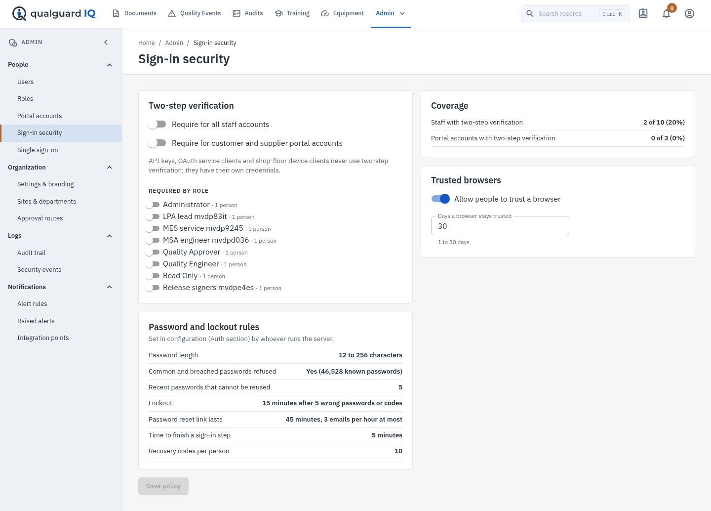
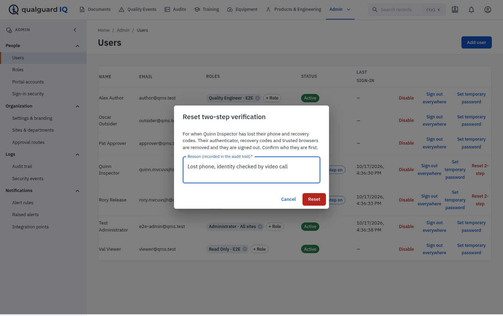

# Administrator guide

All configuration is data. Nothing in the application depends on a particular role name.

## Organization, sites and departments (Admin)

- **Organization settings**: application name, organization name, logo.
- **Sites**: each site has a time zone used for due dates and overdue calculations.
- **Departments**: belong to a site; used to scope permissions and route work.

## Users and roles

- A **role** is a named set of permissions. Grant a role to a user organization-wide, for one site, or for one
  department at a site.
- Permission checks run on the server for every request; changing a user's roles or disabling them takes effect on
  their next request.
- Accounts lock for 15 minutes after five wrong passwords or authentication codes (both set in configuration, see
  below). Unlock from the Users page. Sessions can be revoked there too (**Sign out everywhere**).
- Periodic access reviews are run from Governance › Access reviews.

## Sign-in security (Admin › People › Sign-in security, needs *admin.users*)

- **Two-step verification.** Require it for all staff accounts, for customer and supplier portal accounts, or per role
  (the **2-step required** switch on Admin › Roles, also on this page; it works on built-in roles too). People it
  applies to are taken through set-up straight after their password at the next sign-in and cannot turn it off.
  Configuration can require it for every account (`Auth:Mfa:RequiredForAll`). **Coverage** shows how many active
  staff and portal accounts already use it.
- **Integrations are not affected.** API keys, OAuth client-credential service clients and shop-floor device clients
  have their own credentials and never get a code step. A person who asks for a bearer token at `POST /api/auth/token`
  must send their authenticator code when two-step verification is on for them.
- **Trusted browsers.** Allow or stop "Trust this browser", and set how many days a browser stays trusted (1 to
  `Auth:TrustedDeviceMaxDays`, 30 by default). Only a hash of the browser's token is stored.
- **Password and lockout rules** are shown read only; they come from the `Auth` configuration section (deployment
  guide). The common-password check uses an offline list bundled with the application; nothing is sent anywhere.
- Changes to the policy and to roles are in the audit trail with before and after values.

**On the Users page:**

- **Add user** asks for a temporary password. *Ask for a new password at first sign-in* is ticked by default; the
  person then chooses their own password before anything else opens. Give the temporary password by a separate
  channel, never in the same message as the address.
- **Set temporary password** replaces a forgotten password, signs the person out everywhere and (by default) makes
  them choose a new one at the next sign-in.
- **Reset 2-step** is for someone who lost both their phone and their recovery codes. Confirm who they are first; the
  reason is recorded. Their authenticator, recovery codes and trusted browsers are removed and they are signed out. If
  two-step verification is required for them they set it up again at the next sign-in.
- Chips show **2-step on** and **Must change password** for each person.

**Records.** Every sign-in, failed password or code, step that ran out, recovery code used, two-step change, trusted
browser added or removed, password change, reset request and reset is written to the security log (Admin › Logs ›
Security events) with who, what, when, IP address and browser. Changes to an account (two-step on or off, recovery
codes replaced, temporary password, reset by an administrator) are also in the audit trail. People see their own
entries under **Sign-in history**.

**Email.** Reset links and "your password was changed" notices are sent through `Email:SmtpHost`. Set `App:BaseUrl` to
the address people use so the link points to it. Requests are limited per address (3 per hour) and per IP address,
and the answer is the same whether or not an account exists.

**First administrator.** A new installation's seeded administrator (`Seed:AdminEmail`, `Seed:AdminPassword`) must
choose a new password at the first sign-in.

## Workflow designer (Platform › Workflow designer, needs *admin.organization*)

Approval routes are defined per record type, optionally overridden per site.

- **Stages** run one after another. **Steps** in the same stage run in parallel.
- Each step names the permission a signer must hold, the signature meaning, optional MFA and skill requirements.
- A step may have a **condition** (field, operator, value) so it applies only to matching records, for example
  `severity = Critical`. Every route must have at least one unconditional step.
- **Escalation**: after a number of hours in a stage, users holding the escalation permission are notified once.
- **Preview** shows which steps would apply to an existing record before you save.
- Saving creates a new route version. Approvals already in progress finish on the version they started with.

## Form designer (Platform › Form designer, needs *forms.edit*)

- Form templates are controlled documents; publishing a template follows the document approval route.
- Fields support types, units, limits, patterns, calculated values, cross-field checks, conditional visibility and
  conditional requirement.
- The **component library** holds reusable field groups (for example *Gauge identification*). A component is
  published (needs *forms.approve*) before use; inserting it copies that published version into the template, so later
  library changes do not alter released forms. Create a new component version to change it.
- **Preview** renders the form and evaluates it against sample values before you submit it for approval.

## Business rules (Platform › Business rules, needs *platform.admin*)

| Rule kind | Effect |
|---|---|
| Validation | Blocks submission for approval when the condition matches, with your message |
| Routing | On submission, notifies holders of a permission and can set the due date |
| Escalation | Notifies when matching records stay open past a number of hours |
| Automation | Reacts to platform events (record created, status changed and so on) by notifying |

Use **Test** to evaluate a rule against an existing record. The firing log shows every time a rule acted.

## Data governance (Platform › Data governance)

- Each master data domain has a steward, an owner and a classification (Public, Internal, Confidential, Restricted).
- **Quality rules** (required, unique, pattern, allowed values) are measured with **Measure data quality**; the trend
  is shown per domain. A rule marked *blocking* stops change requests that would break it.
- Changes to master data are requested, approved on the *Master data change* route, then applied automatically.

## Compliance mapping verification (Compliance › Content verification)

Shipped mapping content — every compliance pack's clause list and the PPAP submission level matrix — carries a
verification state: Draft, Unverified, Under review, Verified, Superseded or Rejected. Each version records the source
title, edition, owner/publisher, reference, verification date, verified by, review comments, effective and superseded
dates, a pack version (content fingerprint) and a mapping version. Every state change is kept in the mapping history.

- Packs, coverage and the PPAP page show the state. Unverified content is labelled "not verified", and coverage
  carries a notice that mapping is an evidence aid, not a statement or guarantee of compliance.
- A person with *compliance.edit* submits a version for review with the authoritative source it was checked against
  (clause identifiers and references only, never standard text). A different person with *compliance.verify* verifies
  or rejects it with comments. Rejected versions can be corrected and resubmitted.
- "New version" starts a replacement draft (for example for a new edition); the verified version keeps counting until
  the replacement is verified, then it is superseded. If an upgrade changes shipped content, the old version is
  superseded automatically and the new one starts Unverified.
- Shipped state on 17 October 2026: the PPAP matrix is Verified against AIAG PPAP 4th edition Table 4.2 as reproduced by
  Quality-One ("PPAP Submission Levels" PDF) and Accurate Products ("Retention/Submission Requirements" PDF), which agree
  cell by cell. It was not checked against a licensed copy of the AIAG manual. All pack clause lists, including
  IATF 16949 and AS9100, are Unverified until checked against licensed copies of the standards.

## Retention, continuity and recovery

- An active retention policy for a record type (without product family or regulatory category) sets the retention
  date of files uploaded to records of that type. People with *governance.edit* can extend a file's retention from the
  content library (never shorten it); the change applies to all versions and is written to the security log.

- Retention policies: Governance › Retention.
- Continuity exercises, including disaster-recovery tests: Governance › Business continuity.
- Backups, restore tests and recovery objectives: Platform › Recovery center. See the [recovery guide](recovery-guide.md).

## Marketplace (Platform › Marketplace, needs *platform.admin*)

- Packages are add-ons, quality extensions or industry packs. Each lists the platform modules and other packages it
  needs; it cannot be installed until they are present, and a package others depend on cannot be disabled or removed.
- Installing creates business rules, data quality rules and form library components through the normal engines.
  Components arrive as drafts that a forms approver must publish. Disabling switches the package's rules off;
  uninstalling removes what it created; upgrading replaces it with the new version's content.
- Licensed packages need an activated license key. Keys are verified offline against the publisher key configured in
  `Licensing:PublicKeyPem`; expired or revoked licenses block install, enable and upgrade.
- **License verification keys** (Marketplace › License verification keys): register the publisher's public keys by key
  id; retire a key at rotation (licences it already signed stay valid) or revoke a compromised key (every licence it signed
  stops counting); revoke a licence id from a publisher notice. Signing status shows "refused" until the publisher sets
  up an offline signing machine. See [license-key-custody.md](license-key-custody.md).
- **Licence signing key custody.** The publisher, Shawn Parnell, holds the extension-licence signing private key
  offline and issues every licence key. The private key is never stored in the repository, in configuration, on a
  server or in a deployment. Each deployment sets only `Licensing:PublicKeyPem` (the matching public key, as an
  environment variable or secret); nothing else is needed to verify licences.
- **Import package** adds a package from a manifest file supplied by a publisher.

## Background jobs

The worker runs: document release (hourly), due reminders (daily), alerts, approval escalations and report schedules
(every few minutes), workforce updates (daily) and data exports. Job status is shown on Platform › System health.

## SMS and push providers

**Platform → SMS and push** (`api.admin`) configures providers, message templates and shows the delivery log.
A provider is off until its current configuration passes a connection test; production providers also need
approval by a second person with `integrations.approve`. Only users who opt in themselves receive messages.
The gateway contract, secret handling, retries and receipts are in `docs/setup/sms-push-providers.md`.

## Generated content (optional)

**Platform → Generated content** (`platform.admin`) controls optional generated drafts. The built-in rule-based
features remain the default and the fallback. Drafts are off until the mode allows approved functions, the function
is enabled with a provider, and the provider has passed its connection test (external services also approved by a
second person with `integrations.approve`). Restricted records are never sent, text is redacted, and every request
is logged. See `docs/setup/generation-providers.md`.

## Video playback copies

Set `Video:FfmpegPath` (and optionally `Video:Formats=mp4,webm`) on the worker and API hosts to have uploaded videos
converted into validated MP4 (and WebM) playback copies. The original is always kept. Without a converter, videos
wait in the queue with that requirement shown in the content library. See `docs/setup/video-conversion.md`.
